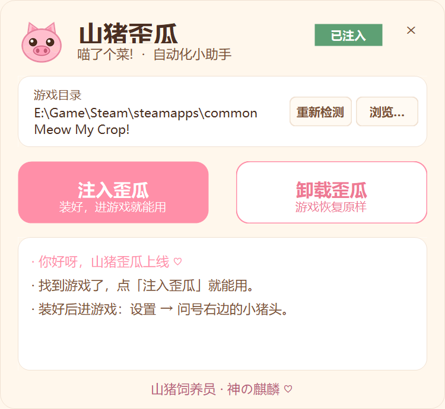

# 山猪歪瓜 · 喵了个菜自动化

<div align="center">


《喵了个菜! / Meow My Crop!》的单机自动化插件 —— 自动种植、自动开罐、自动合成、生长加速、按键倍率、自动兑换码。
游戏设置页里会多出一个粉色小猪头标签页，所有开关都在那里。

**by 神の麒麟**

</div>

---

## 界面

安装器（注入 / 卸载，都会自动关游戏、装完自动重开）：



游戏内：设置（齿轮）→ 标签栏最右边多出一个粉色小猪头，点进去就是下面这些开关。

## 功能

- [x] **自动种植** —— 收完按库存最少的果实补种，库存 99 的跳过
- [x] **自动开罐** —— 按间隔开猫罐头，代币用完自动停
- [x] **自动合成** —— 5 合 1，把多余的东西自动合掉
- [x] **开罐免果实** —— 开罐不扣本地果实（Steam 代币照样扣）
- [x] **生长加速** —— ×1 / ×10 / ×100，只作用于每秒自然生长，点作物仍是原速
- [x] **按键倍率** —— ×1 / ×10 / ×100，一次按键记多次，用来冲按键成就
- [x] **自动偷菜** —— 联机时替你点邻居亮着的偷菜按钮（不绕校验）
- [x] **随机播放唱片** —— 切成随机模式，没在放歌就随一首
- [x] **自动兑换码** —— 扫游戏内置兑换码表，没领的自动领
- [x] **代币面板** —— 普通代币 / 活动代币实时数量

每一行都有悬停说明；倍率行点整行即可切换档位。

## 安装

1. 下载 `山猪歪瓜.exe`（Release 里）
2. 双击运行，它会自动找 Steam 库里的游戏目录（找不到就点「浏览…」手动选）
3. 点「注入歪瓜」—— 如果游戏开着，它会先帮你关掉，写完自动把游戏重新打开
4. 进游戏 → 设置（齿轮）→ 标签栏问号右边的小猪头

卸载同理，点「卸载歪瓜」，删完会自动重开游戏。

## 构建

```bash
# 插件（需要 .NET SDK + 本机已装好游戏）
dotnet build src/MeowAutomation/MeowAutomation.csproj -c Release \
  -p:GameDir="C:\Program Files (x86)\Steam\steamapps\common\Meow My Crop!"

# 安装器（先把 BepInEx + 插件打成 installer/assets/payload.zip）
python tools/make_payload.py --bepinex "<游戏目录>\BepInEx" --dll "<编译出的 MeowAutomation.dll>"
dotnet build installer/Installer.csproj -c Release
```

`payload.zip` 和编译产物不入库（`.gitignore` 已排除），需要自己用上面两步生成。

## 文档

- [功能与原理](docs/features.md) —— 每个功能是怎么实现的，改了游戏的哪个方法
- [限制与风险](docs/limits.md) —— 哪些做不到、哪些会动到 Steam 统计

## 免责声明

单机自用工具，改的是**本地客户端**与**你自己的 Steam 统计**。多人房间里的自动偷菜只是替你点按钮，
不会绕过服务端校验。使用前请自行判断风险，尤其是"按键倍率"会写进 Steam 成就统计。

本项目不包含游戏本体、游戏资源或反编译代码。

## 许可

MIT
